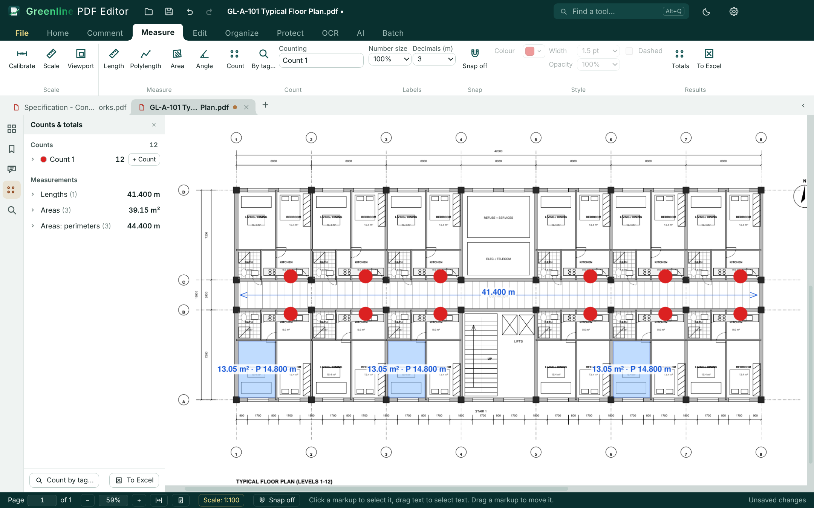
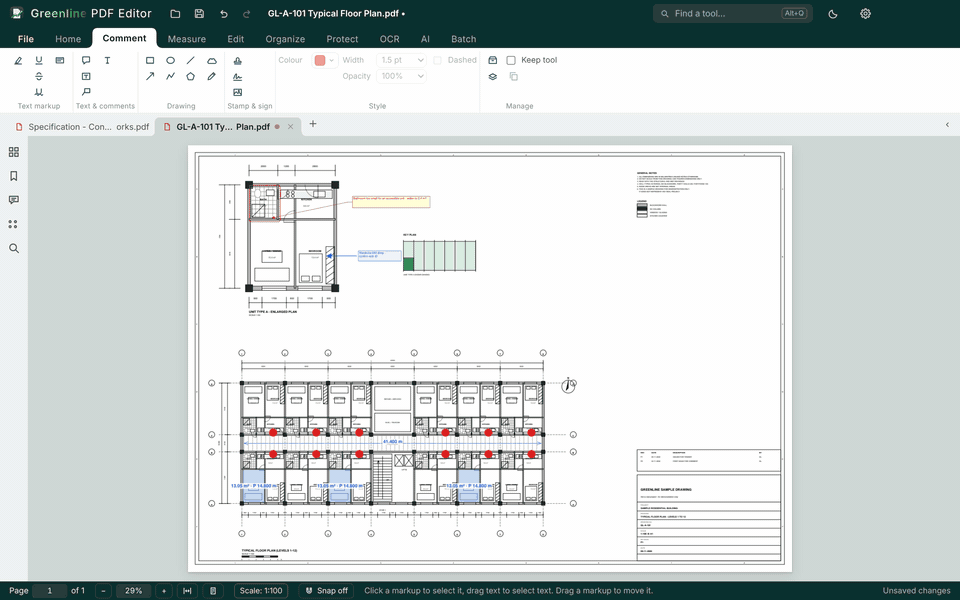
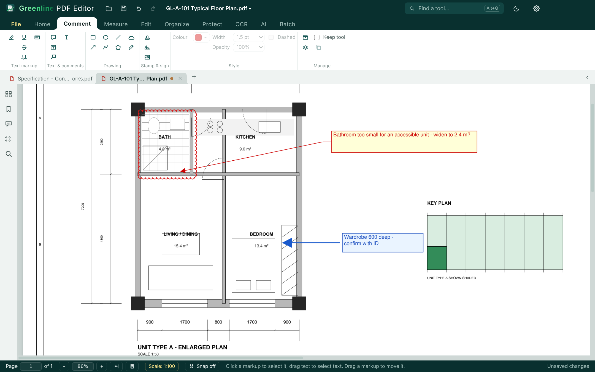
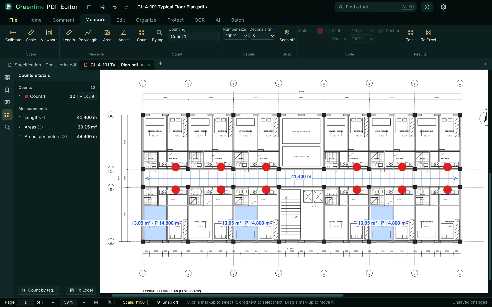

<p align="center"></p>

# Greenline PDF Editor

### The PDF editor that doesn't choke on construction drawings.

500 MB merged drawing sets. A0 sheets traced from CAD with millions of lines. 1,500-page specifications. Scanned tender books. The files that make ordinary PDF editors freeze, run out of memory or quietly crash are the files Greenline was built for. Free, offline, open source.

<p align="center"></p>

## Why it exists

I'm an engineer in the tendering department of a main contractor. Every tender lands as a pile of huge PDFs, and I lost too many hours watching PDF programs hang on them. So I built one that doesn't: speed and stability came first, then the measuring and markup tools a tender needs.

It was built with **Claude 5.5** by Anthropic. I set the requirements and tested it on real tender files; Claude wrote the code.

## Numbers, not adjectives

| | |
|---|---|
| A 317 MB scanned book | opens in **under half a second** |
| A 46 MB sheet of 15 million pen strokes that almost no PDF program could open | opens and draws, simplified to 481 thousand strokes **with no visible change** |
| A 1.26 GB merged drawing set | saves in **about 6 seconds** |
| A drawing engine running out of memory on a monster page | **restarts by itself**; the window and your work carry on |

How: pages are read from disk only as they're needed, never the whole file at once. Drawing, editing and batch jobs each run in their own background engine (a drawing engine can use up to 4 GB), so one overloaded engine can't take the app down with it. An engine that dies is restarted with your file from its last automatic copy.

## What it does

- **Take-off measuring:** set the scale or calibrate on a known dimension, then length, area *with* perimeter, count, and count by tag (e.g. every D-01 door mark on a plan). Corners snap to the drawing - ends, middles and perpendicular - with Ortho, a crosshair and a magnifier for exact points, and any outline can be continued from any corner; totals go straight to Excel.
- **Markups:** clouds, callouts, arrows and text boxes formatted like a word processor; stamps, including your own company seal from a scan.
- **Pages:** merge, extract, insert, reorder and rotate thousands of pages; combine files straight from Windows Explorer's right-click menu.
- **Scans:** OCR in English and Arabic, fully offline.
- **Export:** BOQs and schedules to Excel, documents to Word.
- **Print:** A0 sheets fitted onto A3 or A4, or at actual size for drawings to scale, with a preview of every sheet.
- **Optional:** an AI assistant (Claude or ChatGPT, with your own key) and an offline translator.

<p align="center"></p>

| | |
|---|---|
|  |  |

<sub>The screenshots use a made-up drawing, not a real project: <a href="brand/greenline/screenshots/sample-floor-plan.pdf">try it yourself</a>.</sub>

## Private by design

Your files never leave your PC. The only things that go online are update checks (here, on GitHub), the translator's one-off language download, the AI assistant only when you use it, and problem reports only when you send them (see below).

## Install

Windows 10/11. Download **Greenline PDF Editor Setup &lt;version&gt;.exe** from [Releases](https://github.com/nabilmunla/greenline-pdf-editor/releases/latest) and run it. No admin rights needed.

The setup isn't code-signed yet, so Windows may say "Windows protected your PC": click **More info**, then **Run anyway**.

New versions are announced inside the app (it asks before downloading anything), with what changed in every version since yours. Every update is signed by the publisher and checked before it's installed.

## Reporting problems

**File › Report a problem** sends your words to the developer, anonymously. No GitHub account needed.

- **Sent:** what you type, the picture of the window if you keep it, the app and Windows versions, memory, and the app's recent log.
- **Taken out first:** your Windows user name, the PC's name, every file name, folder and path. The time is rounded to the hour.
- **Never sent:** your PDF files. (The picture of the window, if you keep it, shows whatever is on screen: untick it when that's private.)
- **Crash reports** are **off** until you turn them on (Settings › Help). Only crashes from then on are sent. The same page lists what's sent, with an example.
- **Where they go:** the developer's own [small open receiver](reports-receiver/worker.js), hosted on Cloudflare. No analytics or crash-reporting company. Like any web host, Cloudflare sees your internet address; the receiver doesn't keep it. Read only by the developer, deleted after 6 months.

Prefer to talk in public? [Open an issue](https://github.com/nabilmunla/greenline-pdf-editor/issues).

## Building from source

Needs Node.js 22, Python 3 (with Pillow), Go 1.24 and `rsvg-convert`.

```
npm ci
npm run build        # the app (dist/) and its background engines
npm test             # unit tests
node_modules/.bin/electron . --no-sandbox     # run it
python3 scripts/publish.py <out>              # Windows setup + update package
```

`publish.py` signs the update list with `keys/update-signing-key.pem`, which is not in this repository: make your own key pair for your own builds (`electron/updsig.cjs` holds the public key copies trust). The sample drawings and scans used by most end-to-end tests aren't published either.

## Licence

Free and open source under the **GNU Affero General Public License v3 or later** (see [LICENSE](LICENSE)). It has to be: the editing engine, [MuPDF](https://mupdf.com), is AGPL. You may use, change and share it; if you pass on a changed copy, pass its source with it. Every other part keeps its own licence: see `public/THIRD-PARTY-NOTICES.txt`.
